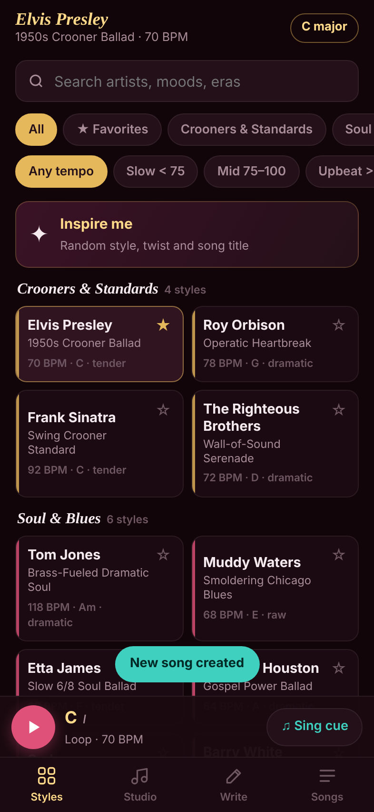
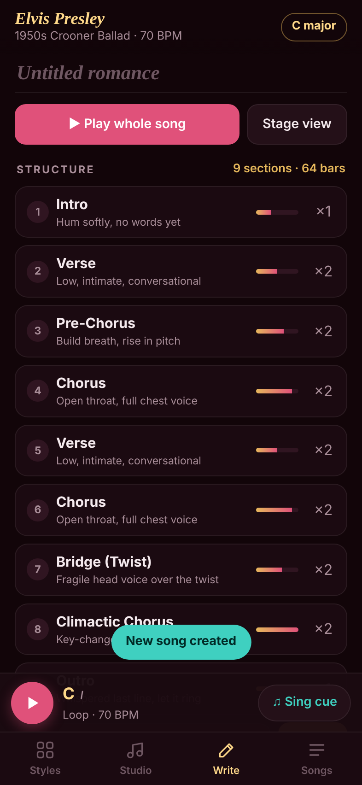
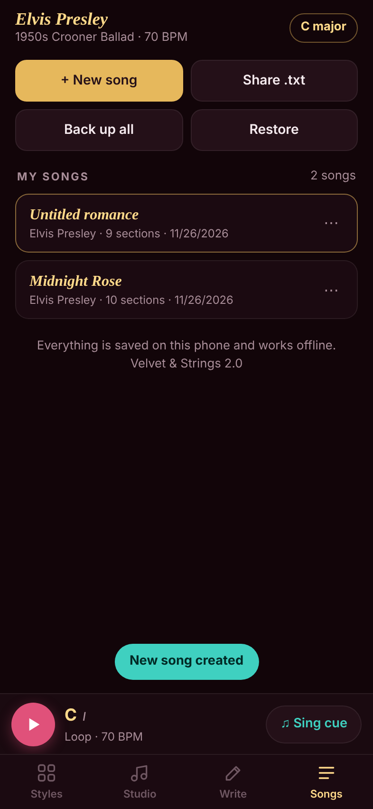

# Velvet & Strings 2.0 — Romance Songwriting Studio

Offline Android songwriting app: HTML5/CSS3/vanilla JS in `www/index.html`, wrapped with Capacitor 7.

**Install:** copy `dist/velvet-and-strings-debug.apk` to an Android phone (Android 6.0+), open it, allow "Install unknown apps".

| Styles | Studio | Write | Songs |
|---|---|---|---|
|  |  |  |  |

## What's inside
- **Styles** — 26 artist archetypes in 6 categories (Crooners & Standards, Soul & Blues, Rock Ballads, Dark & Noir, Dream & Art, Pop & Folk); search, tempo filter, favorites, "Inspire me".
- **Studio** — 4-chord progression with Roman numerals, 3 harmonic twists, chord diagram / ASCII tab / C3–E5 touch piano / vocal pitches (Hz) / reference-tone tuner; tuning (Standard, D Std, Drop D, Drop C) + capo 0–7 transposition; Web Audio synth with 3 grooves, synthesized drums, 4 voice modes, Sing Cue, metronome, count-in, tap tempo.
- **Write** — song sections (8 types, ×1/×2 repeats, 30–100 % intensity, delivery notes, lyrics), *Play whole song* (intensity shapes volume, drums and voices; the bridge plays the twist), Stage view (big text, auto-scroll, keeps screen on), rhyme & imagery bank.
- **Songs** — multiple songs saved on the phone, duplicate/delete, share `.txt` song sheet, JSON backup & restore.
- **Phone** — bottom-tab navigation, mini player, Android back button, haptics, keep-awake while playing, edge-to-edge margins, custom icon & splash, audio stops when the app is backgrounded.

UX patterns borrowed from open-source apps: capo/transpose and setlists (Chord Reader 2), song library, backup and keep-screen-on (Crystal Ball), distraction-free chart view (OpenChordBook), drum/strum patterns (Chord Progression Helper).

## Build
Needs Node 18+, JDK 17+ and the Android SDK (platform 35) with `ANDROID_HOME` set.
```bash
npm install
npx cap sync android
cd android && ./gradlew assembleDebug
# -> android/app/build/outputs/apk/debug/app-debug.apk
```
Test: `node scripts/smoke-test.cjs` (Playwright + Chromium; also writes `screenshots/`).
Icons/splash are generated from `assets/` with `npx @capacitor/assets generate --android`.
