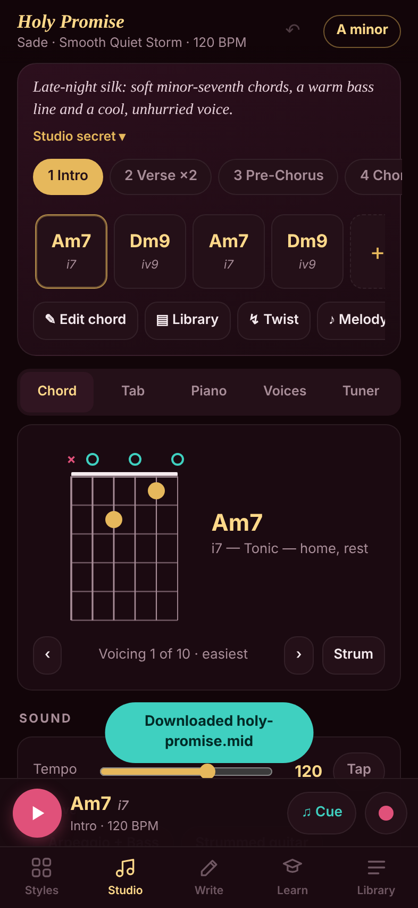
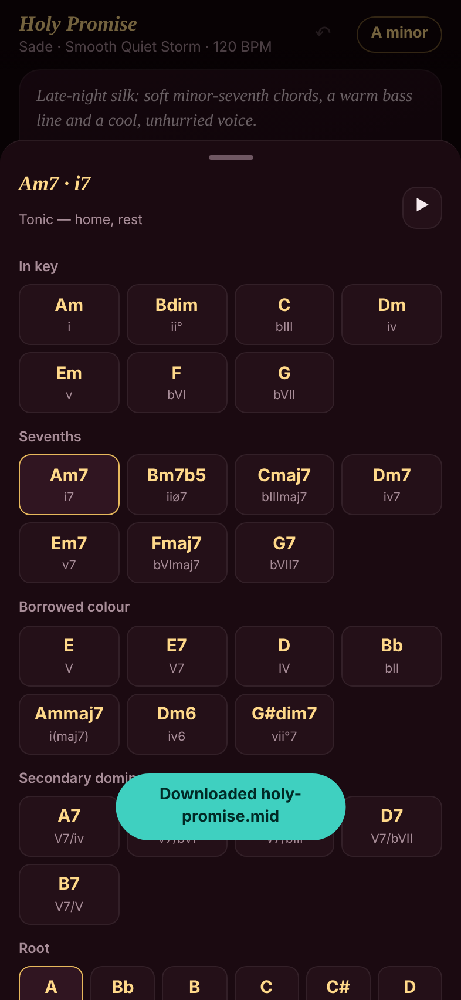
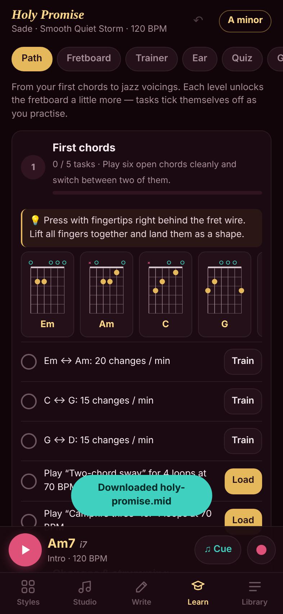
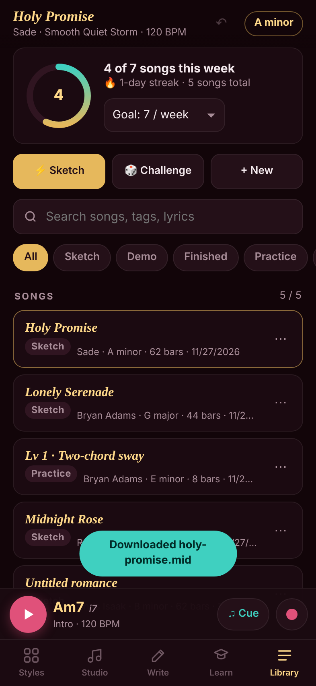

# Velvet & Strings 3.0 — Romance Songwriting Studio

Offline Android app for writing, studying and playing romance songs. Vanilla HTML/CSS/JS wrapped with Capacitor 7.

**Install:** copy `dist/velvet-and-strings-debug.apk` to an Android phone (Android 6.0+), open it, allow "Install unknown apps". It installs over earlier versions and migrates your songs.

| Styles | Studio | Chord editor | Write | Learn | Library |
|---|---|---|---|---|---|
|  |  |  |  |  |  |

## Compose
- **Editable chords for every section**: palette of in-key chords, sevenths, borrowed colour and secondary dominants; any root × 21 qualities, slash bass, ½–4 bar lengths; undo for everything.
- **Progression library**: 24 named patterns (pop axis, doo-wop, Andalusian, 12-bar blues, ii–V–I, line cliché, Canon…) with example song titles (no lyrics).
- **Song forms**: pop, ballad build, 32-bar AABA, 12-bar blues, folk strophic, quick sketch. Per-section key changes (truck-driver lift), repeats ×1–4, intensity.
- **Melody generator** per section (seeded, chord-tone aware, call-and-response phrasing) sung by the lead voice, with harmony/choir under it; solos play a generated guitar line.
- **Twists**: heartbreak iv, Dorian IV, relative swap, secondary dominants.
- **Sound**: Karplus-Strong plucked/strummed guitar, 6 grooves (arpeggio, strum, pad, 6/8, boom-chicka, blues shuffle), 5 drum styles, swing, count-in, click, tap tempo.
- **26 artist archetypes** in 6 categories; open one to start a new song or apply its sound.

## Write
Lyrics per section with **syllable counts and live rhyme-scheme letters**, section-specific tips, rhyme bank (18 families), imagery prompts per category, Stage view (big text, auto-scroll, keep-awake).

## Learn
- **Path**: 8 guitar levels from first chords to jazz voicings; tasks complete themselves (drill scores, 4-loop play-alongs, fretboard quiz, voicing exploration, scales).
- **Fretboard**: chord tones or 10 scales across 15 frets, note/interval labels, left-handed view, note-naming quiz.
- **Trainer**: one-minute chord changes with best scores, speed trainer (auto tempo ramp), practice log.
- **Ear training**: intervals, chord qualities, progressions. **Quiz**: generated theory questions + music-history trivia.
- **Guide**: 8-chapter composing guide, 13 lyric-writing craft tips, section roles, daily 20-minute workout.

## Library
Weekly song goal (1–100) with streaks, ⚡ Quick Sketch (complete song skeleton in one tap), 🎲 Challenges (constraints auto-applied), statuses (Sketch/Demo/Finished/Practice), tags & search, voice-memo idea inbox (record over a loop), exports: `.txt`, ChordPro, **MIDI**, audio memos, JSON backup/restore, whole songbook as ChordPro.

## Phone
Mic tuner (autocorrelation) + reference tones, guitar & ukulele with tunings/capo, Android back button, haptics, keep-awake, edge-to-edge, durable song mirror in app storage.

## Code
`www/js/theory.js` (chords, Roman numerals, voicing generator, melody, lyrics helpers) · `composer.js` (section generators, song → event timeline) · `export.js` (MIDI/ChordPro) · `audio.js` (synth, scheduler, tuner, recorder) · `data.js` (content) · `store.js` · `app.js` · `learn.js`.

## Build & test
Needs Node 18+, JDK 17+, Android SDK platform 35 (`ANDROID_HOME`).
```bash
npm install
npm test                 # unit tests + end-to-end browser test (Playwright/Chromium)
npx cap sync android
cd android && ./gradlew assembleDebug   # -> android/app/build/outputs/apk/debug/app-debug.apk
```
